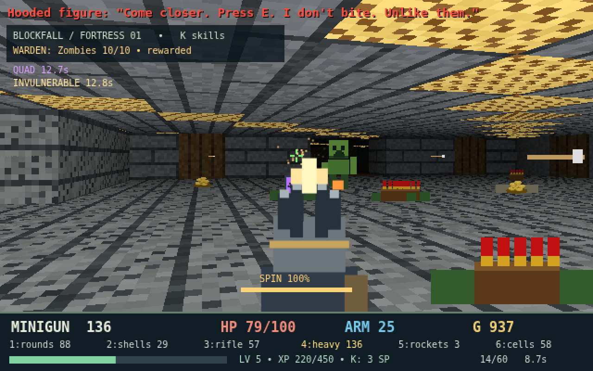

# Doom Built by Grok

A Doom-style browser FPS with Minecraft-style blocks, six guns, a skill tree, NPCs, a global leaderboard, local scores if you are offline, a SoundCloud soundtrack, and an open-world sandbox.

[Play it](https://spencermackenzie335-del.github.io/doom-built-by-grok/)

Sandbox is the main mode: a seeded 192×192 outdoor world with grass, dirt, stone, trees, water, ores, villages, and a day/night cycle. Break blocks, craft, and build a base. The world saves in this browser. Campaign is the original fortress clear, with the same global leaderboard.

## Title

- Enter or click — load the sandbox world, or start one if none is saved
- U — new sandbox world
- C — campaign fortress
- L — leaderboard
- N — toggle music

## Controls

- WASD move
- Shift sprint (eases in and out; walk if you do not hold it)
- H to toggle head bob
- [ and ] to lower or raise mouse sensitivity (saved in this browser)
- mouse aim after clicking the game
- click or Space to fire
- 1-6 or the wheel to switch guns
- E to interact (talk, trade, doors, chests, crafting tables)
- M for the map
- K or Tab for skills
- Q to dash
- L for the leaderboard (global top 10; T toggles your local scores)
- N to toggle music (Fall (LunchBoxxx Remix) by LunchBoxxx on SoundCloud; remembered in this browser)
- R to restart the campaign, or respawn at the village in sandbox
- Escape to pause (Enter resume, T save and title, U new world)

## Sandbox

- Right click to mine the block you face
- B to toggle build mode
- In build mode: left click places the selected block, 1-8 or the wheel picks the hotbar
- C to craft planks, sticks, a table, walls, doors, chests, torches, and a turret (the table and later recipes need a crafting table nearby)
- F to pickpocket a nearby NPC. Level and mobility skills help. It is much harder when they are facing you. Failure makes them hostile and costs reputation
- Killing a villager or Corvin drops their gold and goods and turns the others hostile. Low reputation raises shop prices, then closes the shops. Guards attack if reputation is very low
- Village chests can be looted. The village notices
- Enemies spawn at night and in caves and can break blocks you placed. Turrets shoot back
- The base and world save automatically
